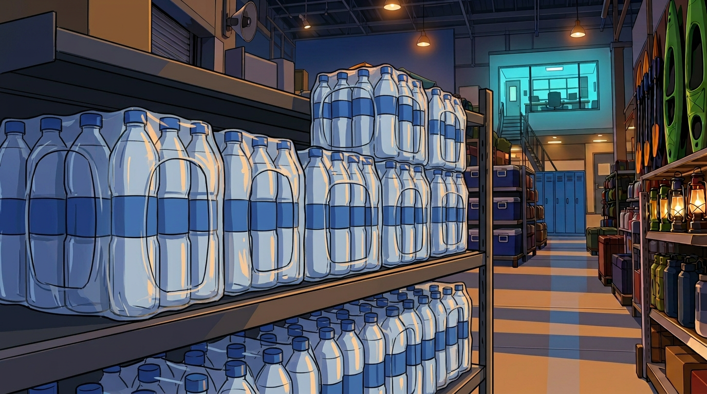
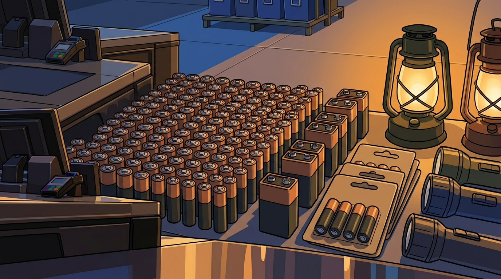
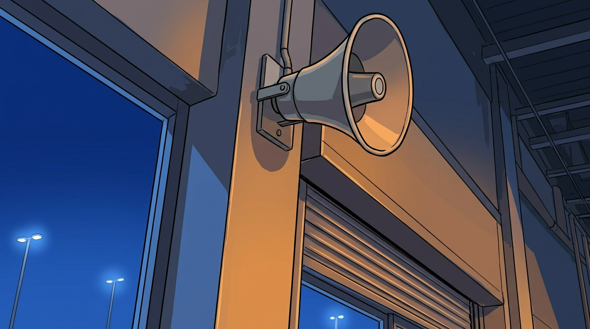
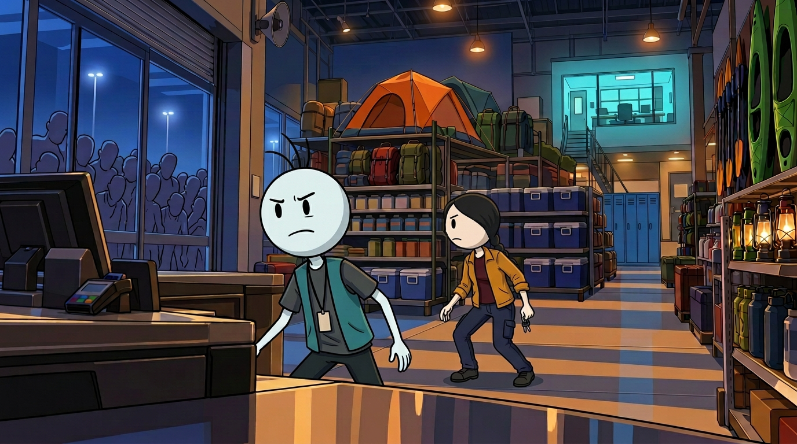
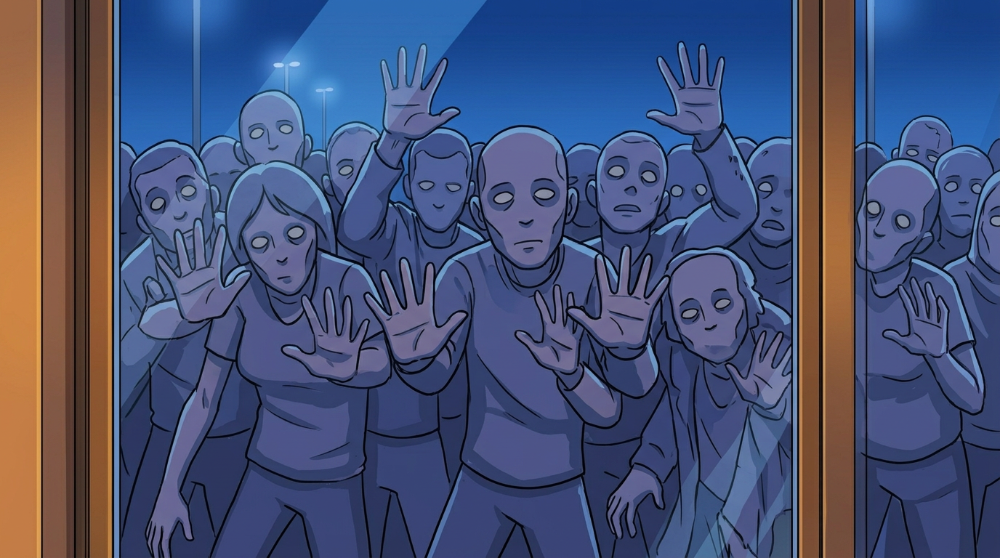

# Opening Pilot — Batch 1 Review (P001–P006)

Status: all six active frames passed assistant per-image and sequence QA on 2026-10-24. P001 and P005 were regenerated after the user's final three-hair-stroke Nolan instruction; P002–P004 and P006 do not contain Nolan and remain accepted. All six files are native 1376×768.

## Narration coverage

Batch 1 covers:

> The store had enough food for months. Enough water. Enough batteries to light every aisle. Unfortunately, it also had a public-address system that would not shut up. Every thirty seconds, a cheerful voice announced another sale. Every thirty seconds, more infected pressed against the front glass.

The complete 12-moment plan in `visuals.csv` reproduces the approved 94-word opening exactly. Actual display timings will be taken from the full master narration's WordBoundary events later, not estimated here.

## Frames

### P001 — Store abundance / active opening master

**Narration:** “The store had enough food for months.”

Regenerated with final C01: nearly circular head, black oval eyes, exactly three curved black hair strokes, thin anatomy and fixed teal/charcoal wardrobe. Lena retains her black braid and keys; expressions, checkout positions, unified lighting, shutter and no-radio state are preserved. The former spiky proof is historical and isolated from active references.

### P002 — Water

**Narration:** “Enough water.”

Cutaway to abundant plain bottled water on the same store shelving. No people or readable labels.

### P003 — Batteries and lighting

**Narration:** “Enough batteries to light every aisle.”

Corrected before batch presentation: the first version looked too much like canned drinks and was moved to `rejected/`. The active frame shows AA/AAA cells, 9V batteries, blank battery packs, lanterns and flashlights.

### P004 — Public-address speaker

**Narration:** “Unfortunately, it also had a public-address system that would not shut up.”

Close insert of the same front-column PA horn, raised shutter housing and blue-night glass. No added glowing device or sound-wave graphics.

### P005 — Another cheerful sale

**Narration:** “Every thirty seconds, a cheerful voice announced another sale.”

Returns to the A01 checkout setup. Nolan's final three-stroke identity, round head, oval eyes, thin anatomy and wardrobe are preserved. Lena's right-side braid and anatomical-right-hand keys are preserved. Neither has a radio or backpack; only head attention and expressions change.

### P006 — Crowd at the glass

**Narration:** “Every thirty seconds, more infected pressed against the front glass.”

Threat-detail cutaway with simplified non-graphic infected outside. The glass remains intact and no infected enter the store.

## Internal sequence review

- P001 → P002 → P003 → P004 are camera inserts; Nolan and Lena remain offscreen at checkout three rather than being silently repositioned.
- P005 returns to the same A01 character state as P001; no travel has occurred yet.
- P006 keeps the infected outside and the glass intact, preserving later shutter and breach states.
- The PA speaker, checkout, tent/cooler/kayak landmarks and cyan office remain in their established locations where visible.
- All active frames use the unified dark-outlined cel-cartoon treatment. Historical realistic, flat-haired and spiky-haired Nolan proofs are not active references.
- All six narration segments match the approved script and all six active images passed native-dimension checks.

## Reference rule for the next batch

Accepted frames may be used with the current identity/location masters for direct continuations. Rejected and superseded frames are moved out of the active set and never guide later images. The user retains final pilot/video review rather than having to clear every individual batch.
