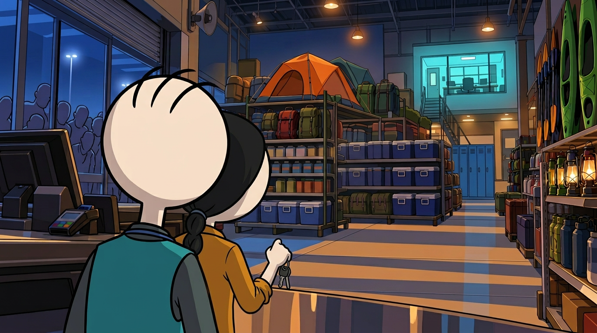
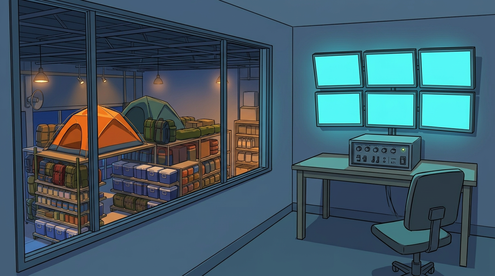
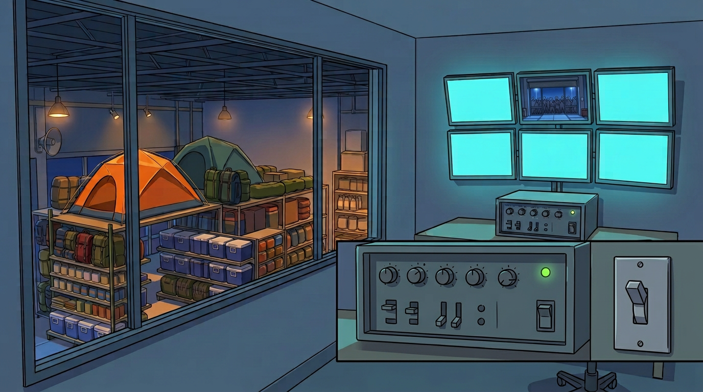
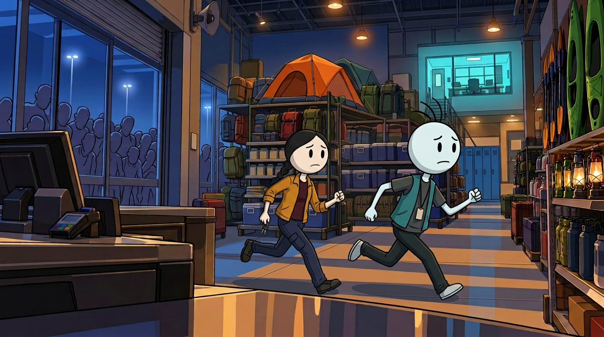
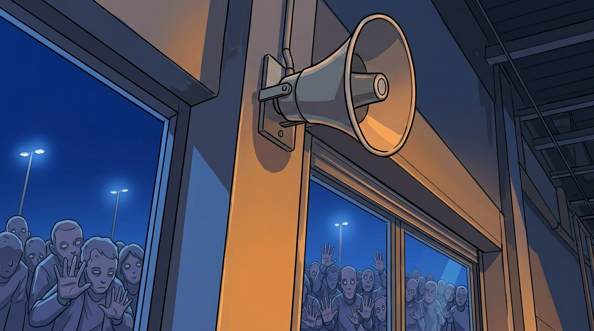
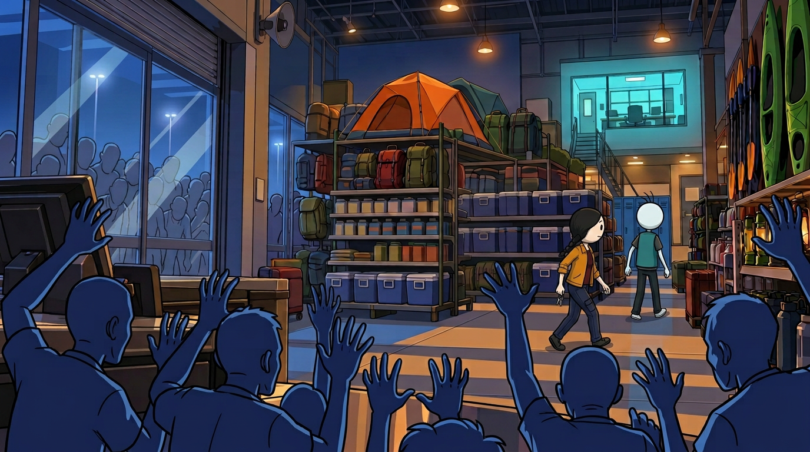

# Opening Pilot — Batch 2 Review (P007–P012)

Status: all six active frames passed assistant per-image and sequence QA on 2026-10-24. P007, P010 and P012 were regenerated after the user's final three-hair-stroke Nolan instruction. Together with Batch 1, the opening has 12 accepted native 1376×768 frames.

## Narration coverage

> From behind checkout three, Nolan could see the security office above the rear wall. The announcement controls were in there. So was the switch for the metal shutter. All he and Lena had to do was cross the store before the next announcement brought the whole crowd through.

## Frames

### P007 — Office objective

Nolan and Lena remain at checkout three and look toward the elevated office. The first new candidate moved Lena too far right and had an ambiguous hair count; it was rejected. The active frame preserves one-step-behind blocking, C02 braid/right-hand keys and exactly three visible strokes on Nolan's round head. Lena is partially occluded by the over-the-shoulder composition, but her identity and position remain readable.

### P008 — Announcement controls

The first version showed an exterior window and was rejected. The accepted office overlooks the orange tent and blue coolers on the sales floor below.

### P009 — Shutter switch

The first version suggested a partially lowered shutter and pseudo-labels. The accepted frame has blank controls, a powered PA and a raised-shutter monitor.

### P010 — Crossing begins

Earlier versions sent the characters in the wrong direction or omitted Nolan's hair strokes and were rejected. The active frame has Nolan leading toward screen-right/office, Lena following with black braid/right-hand keys and no early radio. An enlarged review crop confirmed exactly three hair strokes; other nearby dark lines belong to the rear staircase.

### P011 — Next announcement

The same PA horn/column returns with the crowd outside intact glass and the shutter raised.

### P012 — Deadline

The crowd remains outside the intact storefront while the protagonists continue toward the office. Nolan's three-stroke silhouette remains visible at the wider scale. The image does not prematurely show the future breach.

## Full-sequence review

- P001–P006 establish abundance, the PA and the external crowd without moving the protagonists during cutaways.
- P007 changes only their attention/camera objective; P008–P009 are cutaway previews, not character teleports into the office.
- P010 is the first actual travel beat and establishes screen-right motion toward the office.
- P011 returns to the active sound source; P012 continues the same crossing while keeping the infected outside.
- Nolan's round head, black oval eyes, exactly three hair strokes, thin anatomy and wardrobe remain locked. Lena's black hair/braid/key hand and wardrobe remain locked. No character has a radio or backpack during this opening paragraph.
- All rejected and superseded versions are isolated under `rejected/` and are not listed as active continuation references.
