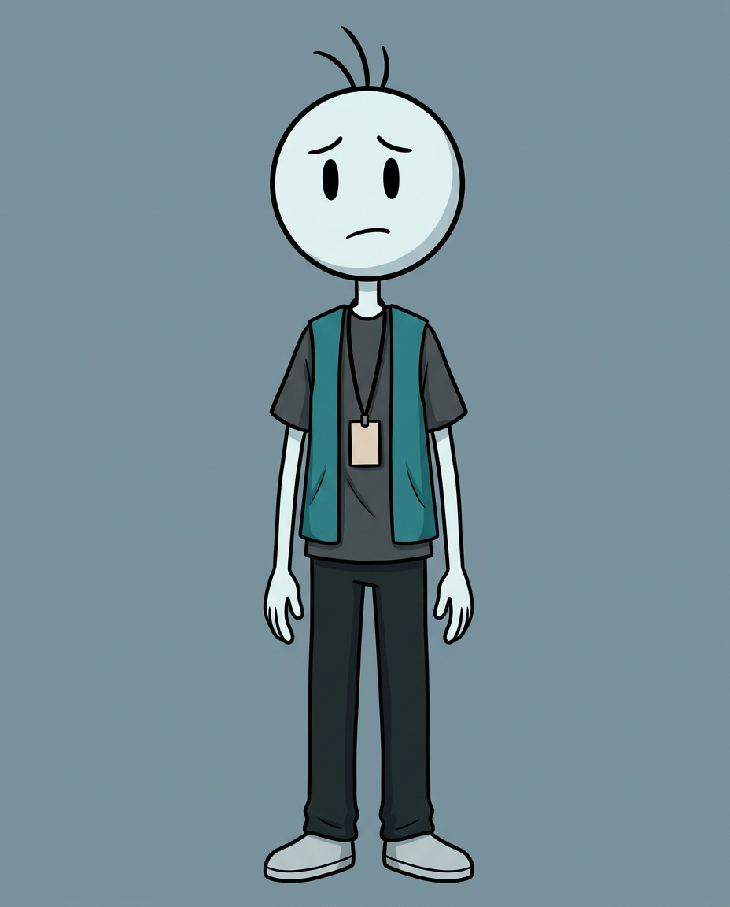
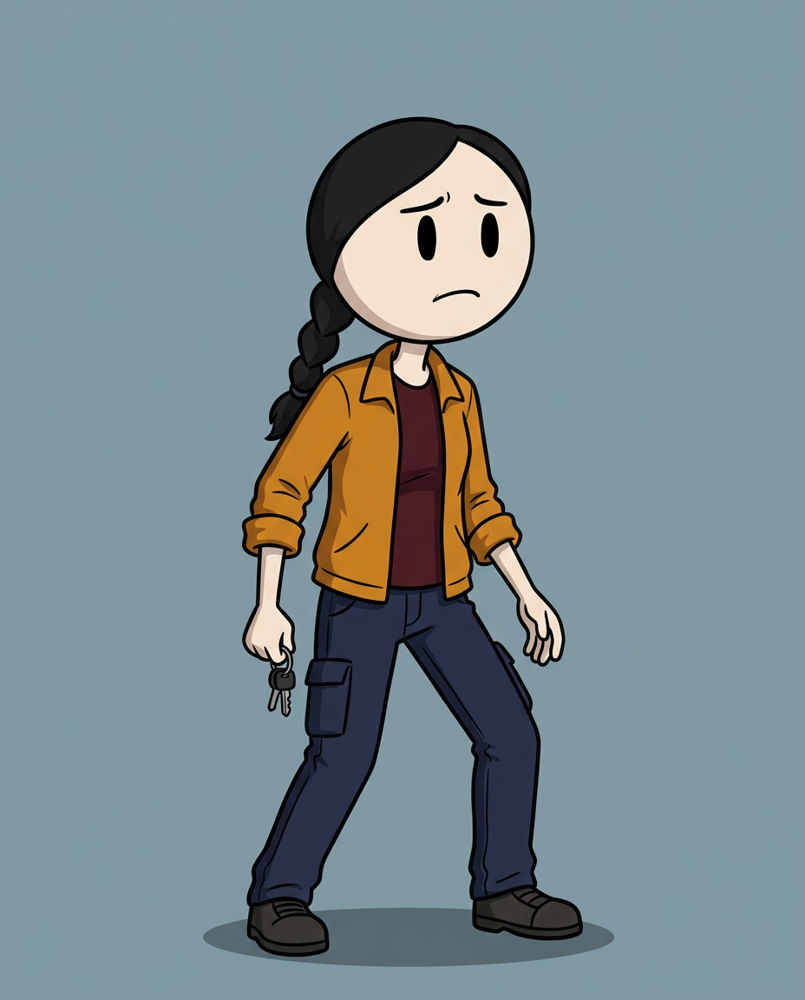
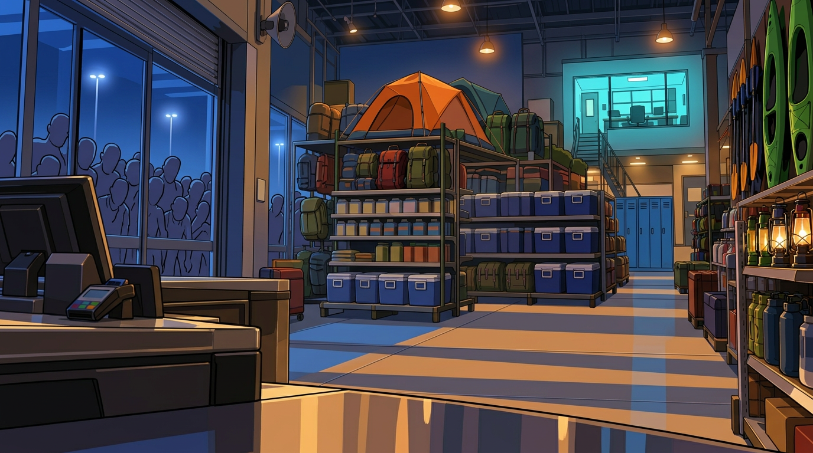
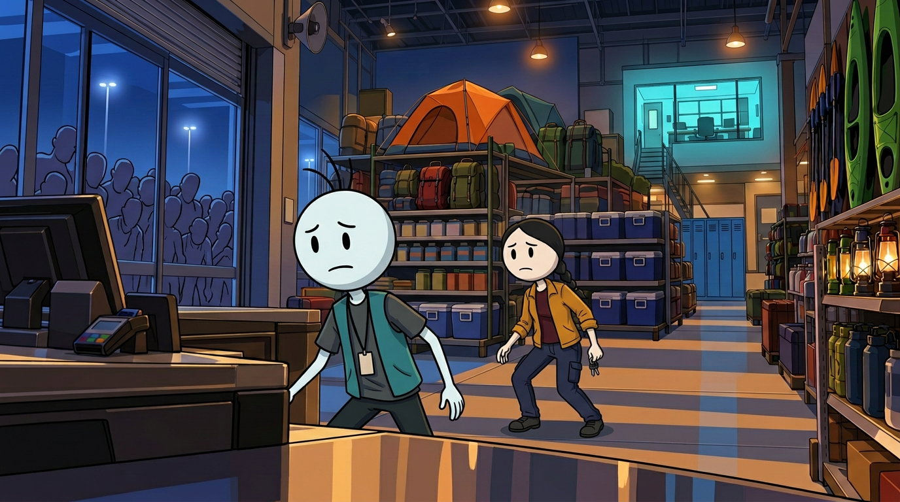

# The Store Had Everything — Opening Reference Pack

Status: **active final-identity pack, corrected 2026-10-24.** Nolan now has exactly three simple curved black hair strokes by explicit user instruction. Every other character, wardrobe, performance, environment, lighting and continuity requirement remains binding. All 12 active opening frames have passed assistant QA; final assembled-pilot review remains available to the user.

## Pack purpose

This pack separates character identity, general construction, environment and geography so later prompts do not reinvent them together. Accepted combined frames prove that the pieces work together; identity sheets and style tests do not replace that review.

## S00 — User construction and final Nolan-hair source

**File:** `character_style_user.jpg`

**Role:** round-head, minimal oval-eye, thin-limb construction and Nolan's exact three-stroke hair shape. It does not control wardrobe, colour, environment or composition.

## S01 — Original hybrid: historical only

**File:** `examples/the_store_had_everything/style_tests/hybrid_opening_establishing.png`

**Dimensions:** 1672×941

**Status:** historically selected, but not active. Its realistic background was rejected and its spiky Nolan hair was superseded by the user's final instruction. Do not use it to guide new images.

## S02 — Unified cartoon rendering anchor

**File:** `examples/the_store_had_everything/style_tests/unified_cartoon_opening.png`

**Dimensions:** 769×1363

**Status:** selected as the closer visual-language match. Portrait rendering reference only; never insert it into the widescreen video or let it override identities/geography.

## C01 — Nolan identity

**File:** `nolan_identity.png`

**Dimensions:** 928×1152

- Nearly circular pale head with a clean dark outline and black vertical oval eyes.
- **Exactly three separate curved black hair strokes on the otherwise bald top of the head.** Never omit them in profile; never add a fourth, brown hair mass, fringe, spikes or side hair.
- Simple brows and mouth, no realistic nose detail, thin neck and limbs, and stable approximately 3.5-head proportions.
- Teal fleece vest, charcoal shirt, dark trousers and dark sneakers with pale/light soles.
- Blank badge on a dark lanyard.
- No backpack, radio or hand props in this identity image or the opening paragraph.

The former spiky C01 is archived under `rejected/` and is not an active reference.

## C02 — Lena identity

**File:** `lena_identity.png`

**Dimensions:** 928×1152

- The same simple character construction and approximate proportions as Nolan.
- Round head, black oval eyes, smooth black hair and one narrow braid over her anatomical right shoulder when visible.
- Amber delivery jacket, burgundy shirt, navy cargo trousers and dark work shoes.
- Van keys are canonical in her **anatomical right hand**; this is the viewer-left hand in the straight-on reference.
- No backpack or radio in the opening paragraph.

## L01 — Approved unified opening store background

**File:** `opening_store_background.png`

**Dimensions:** 1376×768

- Clean dark environmental outlines, simplified geometric props and two/three-tone cel shading.
- Front glass, blue night and simplified non-graphic infected crowd remain at frame-left.
- Raised shutter housing and overhead public-address speaker remain visible.
- Orange tent, blue coolers and green kayak wall are fixed landmarks.
- Rear stairs and elevated cyan-lit security office remain at rear-right.
- Broad graphic amber/blue floor-light bands replace the rejected realistic reflections.

The earlier realistic plate is retained only as `examples/the_store_had_everything/style_tests/rejected_realistic_opening_background.png`; it is not an active reference.

## P01 — Active combined opening master

**File:** `examples/the_store_had_everything/opening_pilot/frames/P001.png`

**Dimensions:** 1376×768

The active P001 combines L01 with the final C01/C02 identities, exact three-stroke Nolan hair, established checkout blocking, expressive faces, vivid unified lighting and the correct opening prop state. The earlier `style_tests/unified_cohesion_proof_corrected.png` is historical only because it contains the superseded hair.

## M01 — Store schematic and geography

**Files:** `store_floor_plan.svg`, `STORE_GEOGRAPHY.md`

The schematic fixes the front/checkouts, camping landmarks, direct aisle, rear stairs, elevated office, stockroom, loading bay, van direction and alarmed side exit. It also records the opening route and later state changes.

[Open the store floor plan](store_floor_plan.svg)

## Prompting and continuity rules

- `PROMPT_BIBLE.md` defines reference hierarchy, canonical identity/wardrobe descriptions, prompt order and negative constraints.
- `examples/the_store_had_everything/CONTINUITY_PROTOCOL.md` defines scene-state and sequence-review requirements.
- `examples/the_store_had_everything/OPENING_PILOT_PLAN.md` defines initial blocking and reusable-audio/frame production.
- Direct continuations use identity/location masters plus the last accepted generated frame. Rejected frames and incompatible future states are forbidden references.

## Internal visual QA

| Asset | Result | Notes |
|---|---|---|
| S01 original hybrid | Historical only | Realistic environment and spiky Nolan hair are both inactive. |
| S02 unified cartoon | Rendering anchor retained | Portrait style reference only. |
| First cohesion proof | Rejected | Nolan's hair flattened; Lena's spacing/braid also drifted. |
| Former spiky cohesion proof/C01 | Superseded and isolated | Not valid after the user's final three-stroke instruction. |
| New C01 | Accepted internal QA 2026-10-24 | Round head, oval eyes, exactly three strokes, thin anatomy and fixed wardrobe. |
| Active P001/P005/P007/P010/P012 | Accepted after regeneration | Final Nolan identity propagated; all other details reviewed. |
| C02 and L01 | Remain active | Black braid/right-hand keys and fixed unified store geography preserved. |
| M01 schematic | Pass | Valid SVG; relationships match written geography. |

## Approval record

The user explicitly selected the three-stroke Nolan identity to improve repeatability and clarified that every other detail still matters. The assistant owns continuing per-frame and sequence corrections. Only the current accepted files listed here and in `visuals.csv` may guide production.
